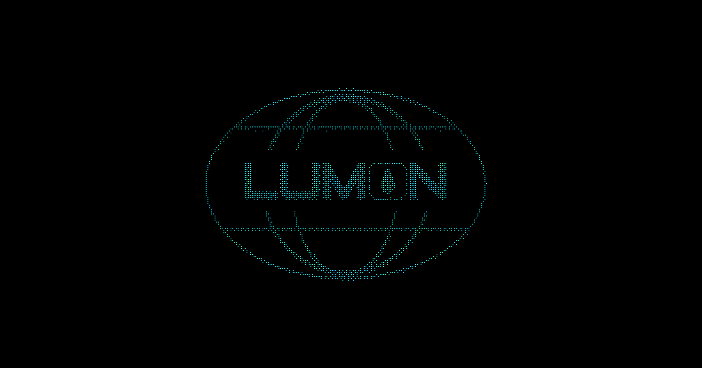

[//]: # (APRIL FOOLS! BY TERMINAL TROVE)

# Lumon



lumon is a TUI (Text-based User Interface) application inspired by the workplace experience at Lumon Industries from the TV show "Severance."

## Description

Lumon is an interactive terminal experience that simulates the macrodata refinement process shown in the TV series "Severance."

This TUI application is built using the [Bubble Tea](https://github.com/charmbracelet/bubbletea) framework and related libraries from Charm.

## Installation


### eget

```bash
eget terminaltrove/lumon
```

### Github Releases

You can download `lumon` from GitHub releases [for your platform here](https://github.com/terminaltrove/lumon/releases).

## Disclaimer

This project is not affiliated with, endorsed by, or connected to Apple TV+, "Severance," or Lumon Industries (which is fictional).

## Acknowlegements

- Inspired by the TV show "Severance" on Apple TV+
- Built with [Bubble Tea](https://github.com/charmbracelet/bubbletea), [Lip Gloss](https://github.com/charmbracelet/lipgloss) from our friends at [Charm](https://charm.sh/)
- To you for checking and trying out lumon!

EOF


[//]: # (APRIL FOOLS! BY TERMINAL TROVE)
