<div align="center">
  <h1>lumon</h1>
  <p>The work is mysterious and important...</p>
  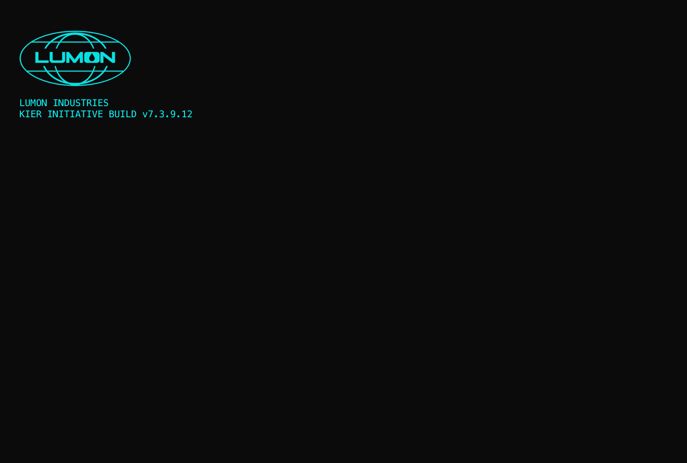
  <br><br>
  <p>
    
    
    
  </p>
</div>

## Description

Lumon is an interactive terminal experience that simulates the macrodata
refinement process shown in the TV series _"Severance."_

This TUI application is built using the [Bubble Tea](https://github.com/charmbracelet/bubbletea)
framework and related libraries from [Charm](https://charm.sh/).

## Play

- **On the Web:** [terminaltrove.com/lumon/](https://terminaltrove.com/lumon/)
- **Over SSH:** `ssh lumon.terminaltrove.com`
- **On your machine:** Download `lumon` for your platform from
  [releases](https://github.com/terminaltrove/lumon/releases), then run `./lumon`

## Installation

### From GitHub Releases

You can download the latest binary from GitHub releases
[for your platform here](https://github.com/terminaltrove/lumon/releases).

### Using Homebrew

```bash
brew install terminaltrove/tap/lumon
```

### Using eget

```bash
eget terminaltrove/lumon
```

### Using Go

```bash
go install github.com/terminaltrove/lumon/cmd/lumon@latest
```

### Build from Source

Requirements: Go 1.26.11 or later

```bash
git clone https://github.com/terminaltrove/lumon.git
cd lumon
go build -o lumon ./cmd/lumon
# or: ./scripts/build.sh   for every target, into dist/, with checksums
```

## Features

- Find the corrupt clusters in the grid and refine them into five bins
- A fisheye lens that grows the digits under your cursor and pushes the grid apart
- Clusters that swell, redden and eventually detonate if you leave them
- Up to four refiners on a file, on the public server or on your own network
- Computer refiners for company, nine colour themes, and mouse support
- Type `KIER` for a nice treat ;)

## Screenshots

<table>
  <tr>
    <td align="center"><br><sub>Scary numbers growing under the cursor</sub></td>
    <td align="center">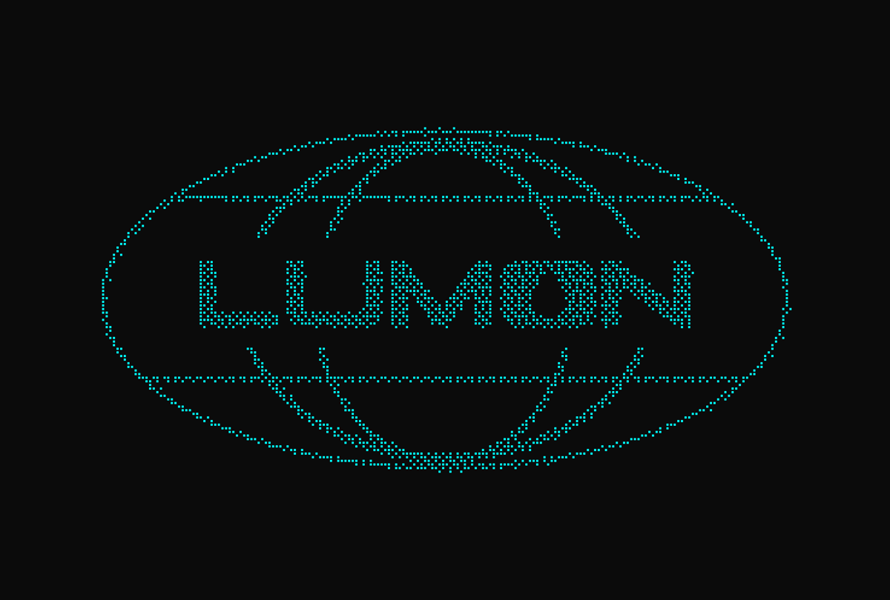<br><sub>The Lumon logo at startup</sub></td>
    <td align="center">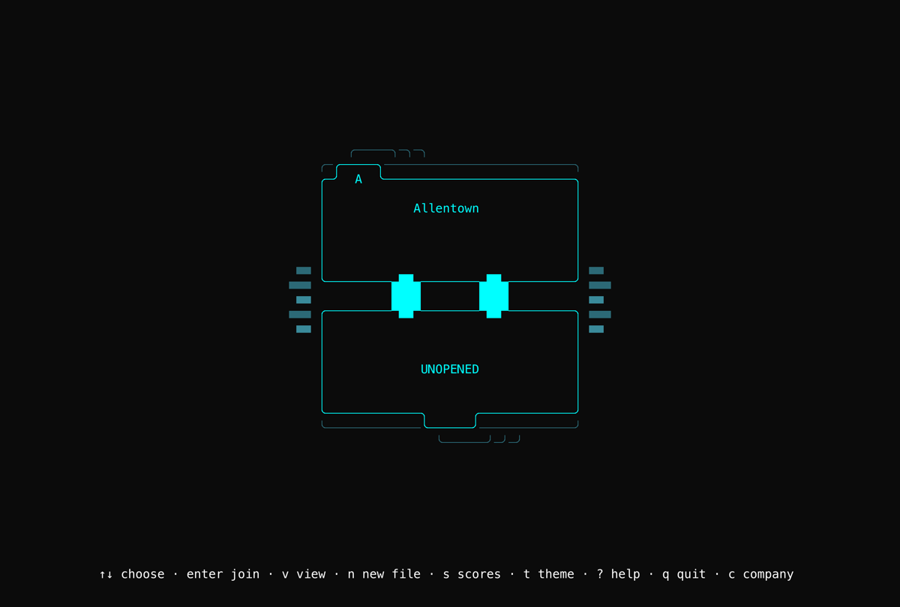<br><sub>Choosing a file</sub></td>
  </tr>
  <tr>
    <td align="center">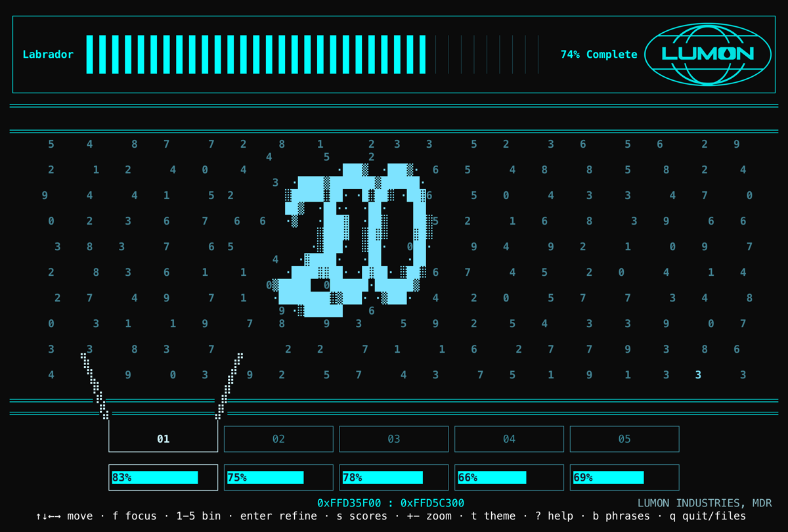<br><sub>Refined numbers flying into bin 01</sub></td>
    <td align="center">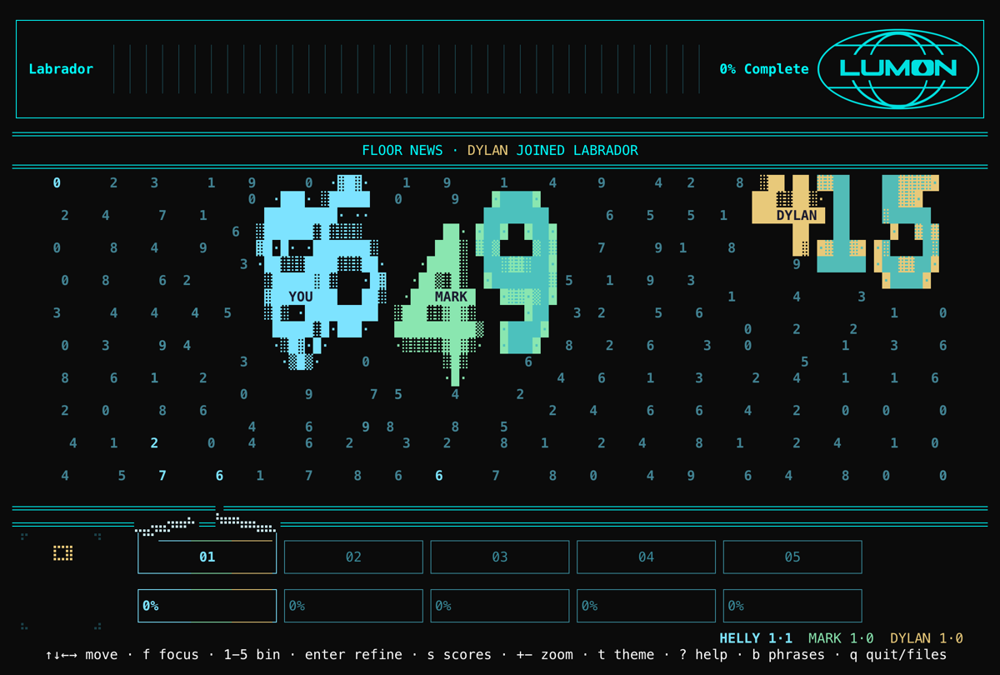<br><sub>Three refiners on one file</sub></td>
    <td align="center">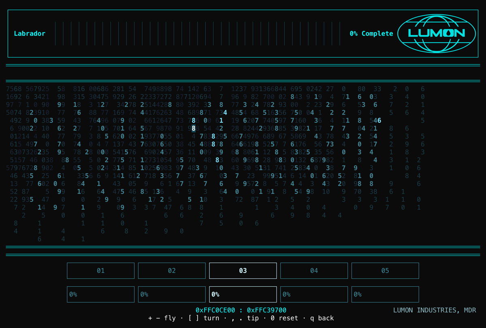<br><sub>The file in 3D</sub></td>
  </tr>
  <tr>
    <td align="center">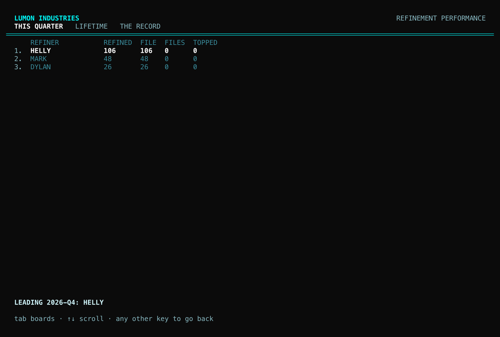<br><sub>Standings</sub></td>
    <td align="center">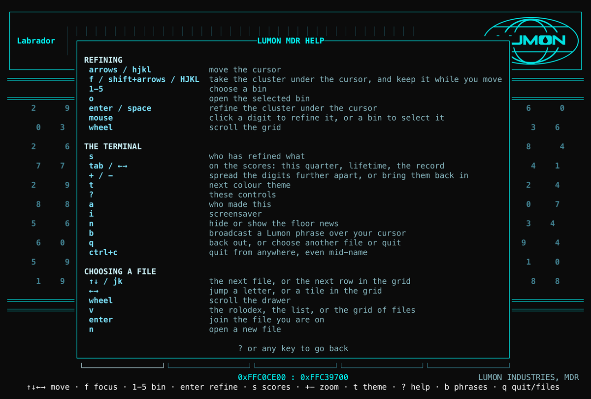<br><sub>Controls</sub></td>
    <td align="center">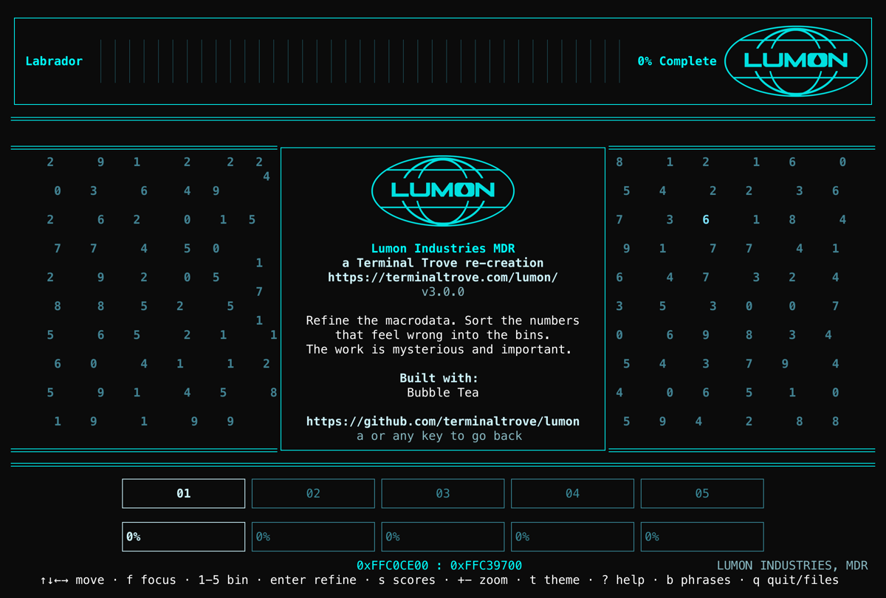<br><sub>Credits</sub></td>
  </tr>
</table>

Four of the nine themes, on the same board:

<table>
  <tr>
    <td align="center">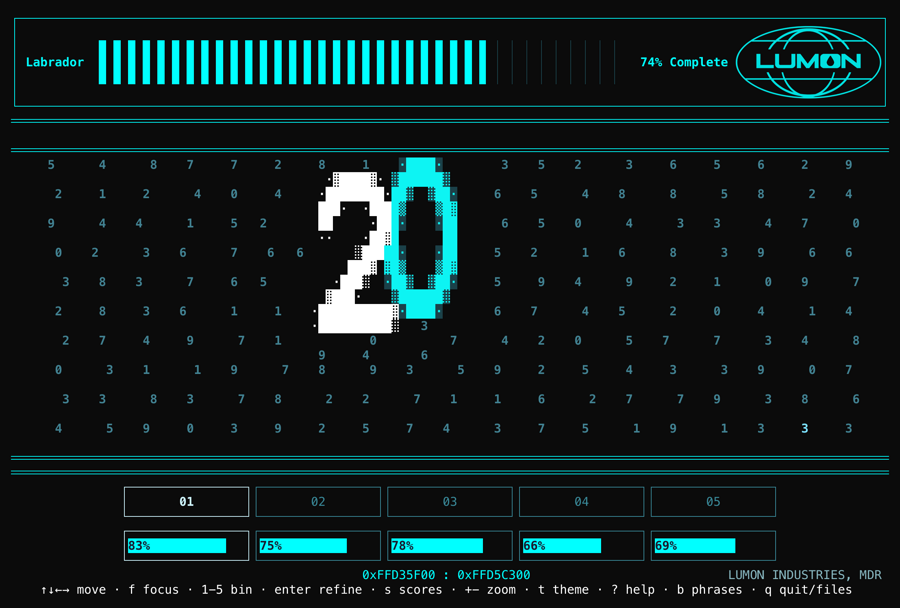<br><sub>lumon</sub></td>
    <td align="center">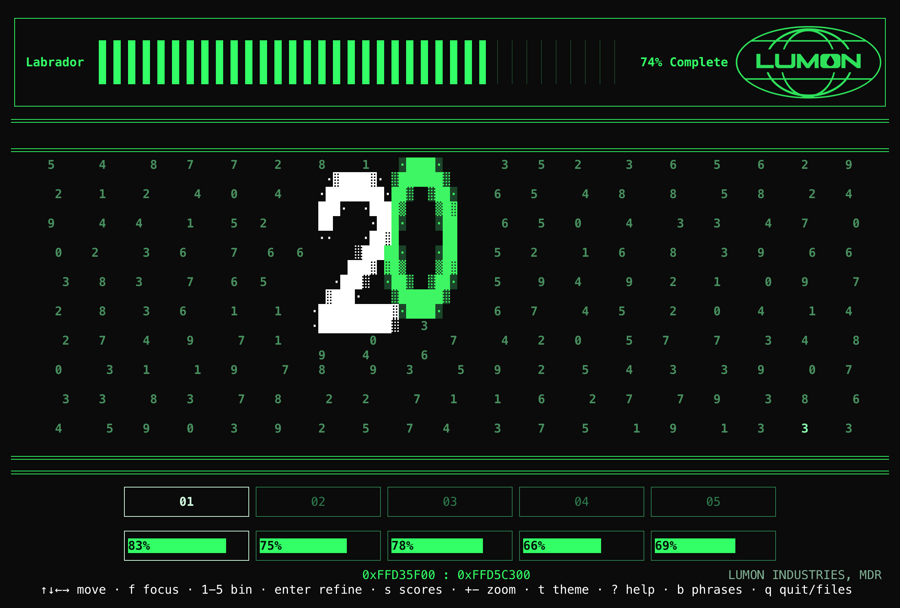<br><sub>phosphor</sub></td>
    <td align="center">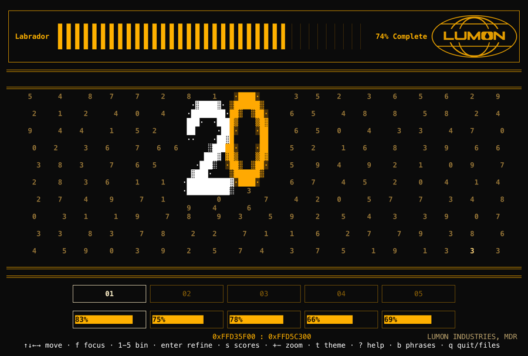<br><sub>amber</sub></td>
    <td align="center"><br><sub>trove</sub></td>
  </tr>
</table>

### Preview

<table>
  <tr>
    <td align="center"><br><sub>The boot log, then the Lumon logo</sub></td>
    <td align="center">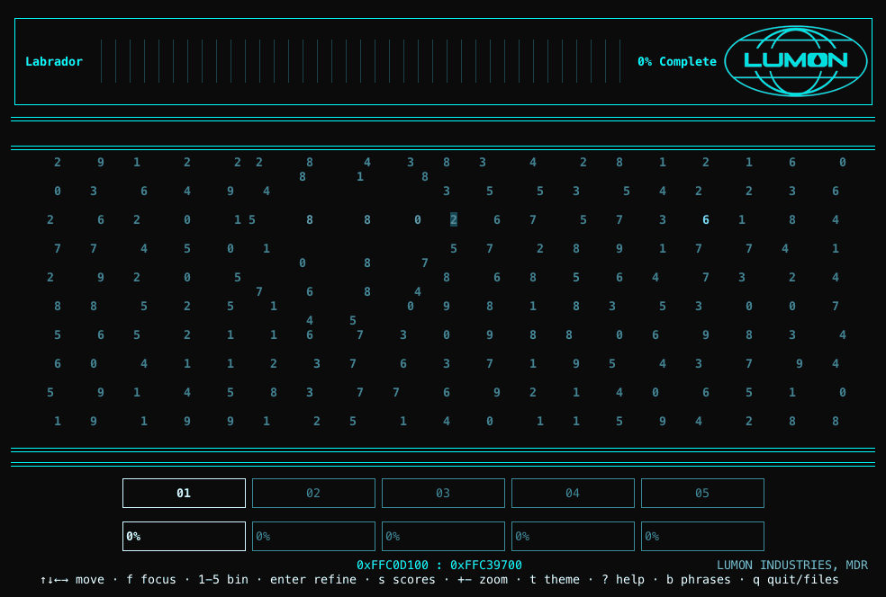<br><sub>Taking a cluster, choosing a bin, and refining it</sub></td>
  </tr>
  <tr>
    <td align="center">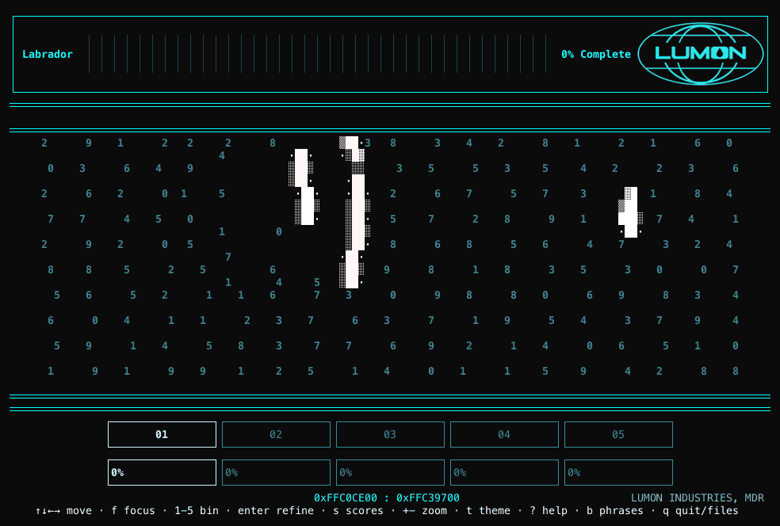<br><sub>An unrefined cluster exploding across the board</sub></td>
    <td align="center">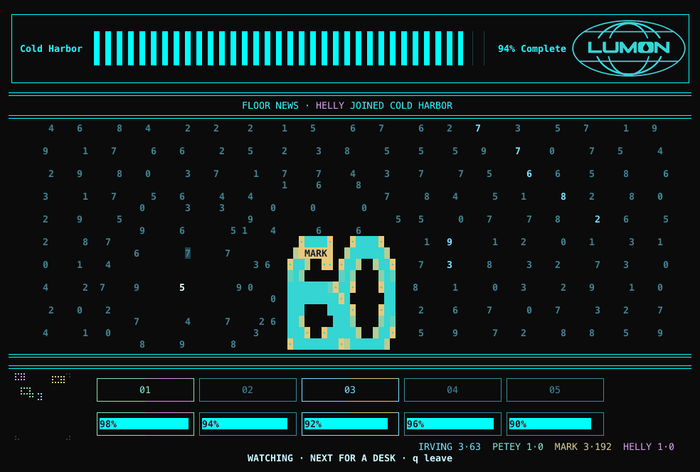<br><sub>Mark and Helly finishing Cold Harbor</sub></td>
  </tr>
  <tr>
    <td align="center" colspan="2">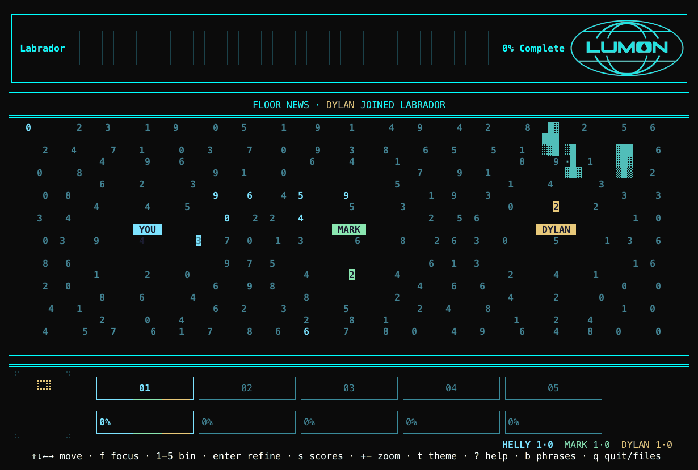<br><sub>Helly, Mark and Dylan refining Labrador together</sub></td>
  </tr>
</table>

## Usage

### TUI Controls

- `↑` `↓` `←` `→` or `h` `j` `k` `l` - Move the cursor
- `f` - Take the cluster under the cursor
- `1`-`5` - Choose a bin
- `enter` or `space` - Refine the cluster under the cursor
- `?` - Every control
- `q` - Back out, or quit

The full list is in [docs/controls.md](docs/controls.md).

## Recommended terminals

[Ghostty](https://ghostty.org/), [WezTerm](https://wezterm.org/),
[iTerm2](https://iterm2.com/) or [kitty](https://sw.kovidgoyal.net/kitty/) are
recommended. See more at [docs/terminals.md](docs/terminals.md).

## More

- [Computer refiners](docs/playing.md#computer-refiners) and the full feature list
- [Playing with others over the LAN](docs/lan.md)
- [Agent Plugins](docs/agent-plugins.md): Agent plugins for Claude Code, Pi and OpenCode.

## Development

```bash
make help                          # every task
make test                          # the suite, under the race detector
make check                         # fmt, vet and test
```

For inline plugin development (Bun 1.3.14 or later):

```sh
bun install --frozen-lockfile --ignore-scripts
bun run check:plugins
bun run test:plugins
```

The integration tests build this checkout's native game and exercise embedded
rendering, input, resizing, activation defaults and cleanup.

## License

MIT, in [LICENSE](LICENSE). Third-party licences are in [licenses/](licenses/).

## Disclaimer

This project is not affiliated with, endorsed by, or connected to Apple TV+,
"Severance," or Lumon Industries (which is fictional).

## Acknowledgements

- Inspired by the TV show "Severance" on Apple TV+
- Built with [Bubble Tea](https://github.com/charmbracelet/bubbletea) and
  [Lip Gloss](https://github.com/charmbracelet/lipgloss) from our friends at
  [Charm](https://charm.sh/)
- The physics is ported from [inertia](https://github.com/aclfe/inertia) by
  Kairav Mittal
- To you for checking out and trying lumon!

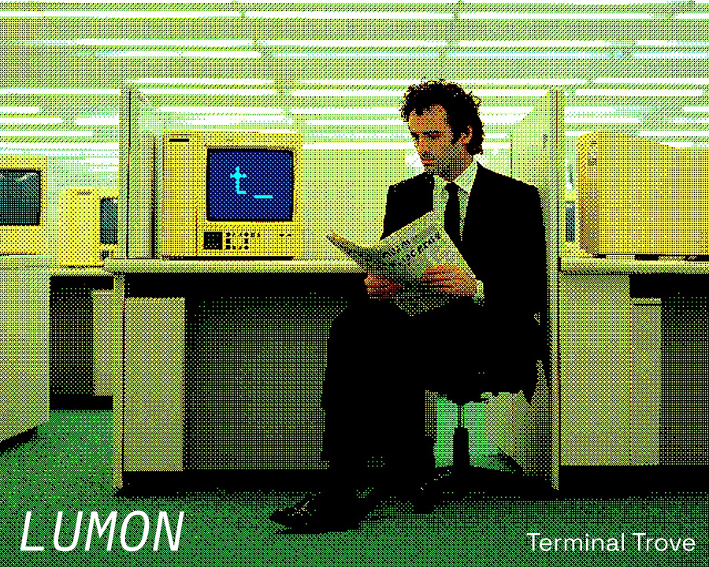
